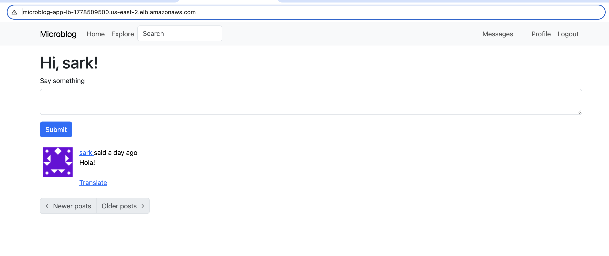
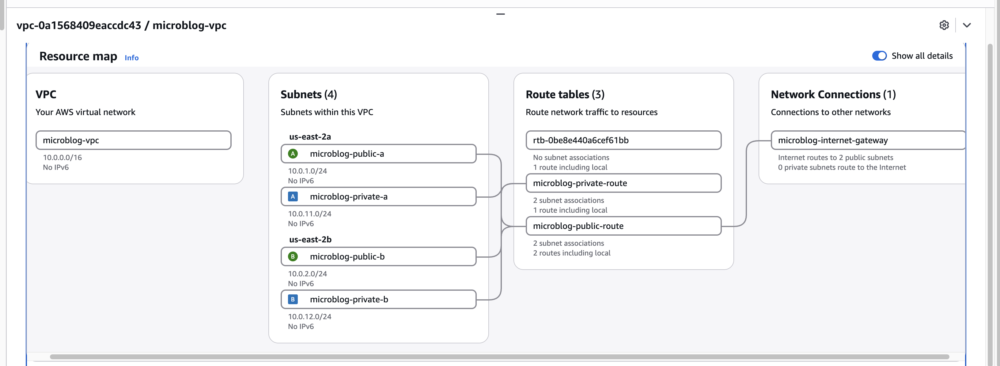
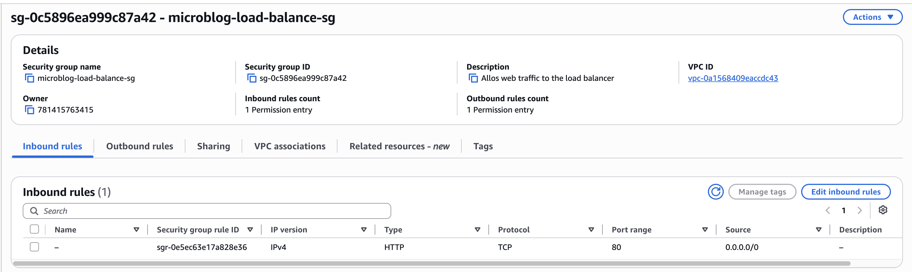
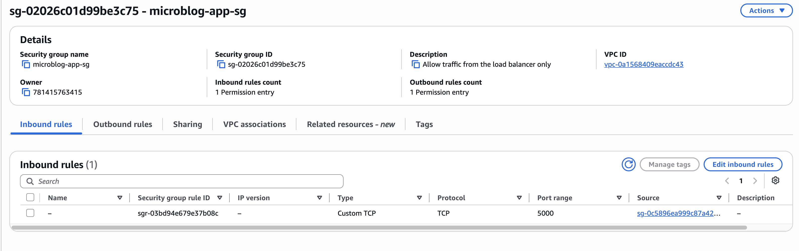
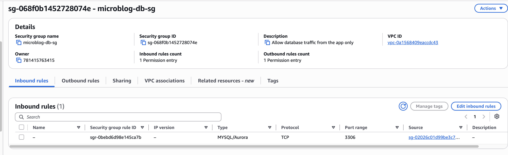
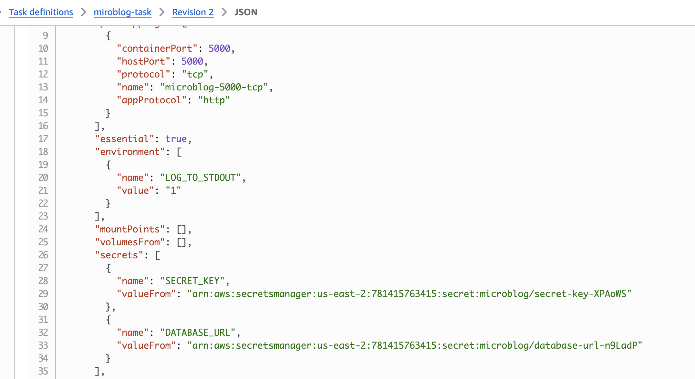
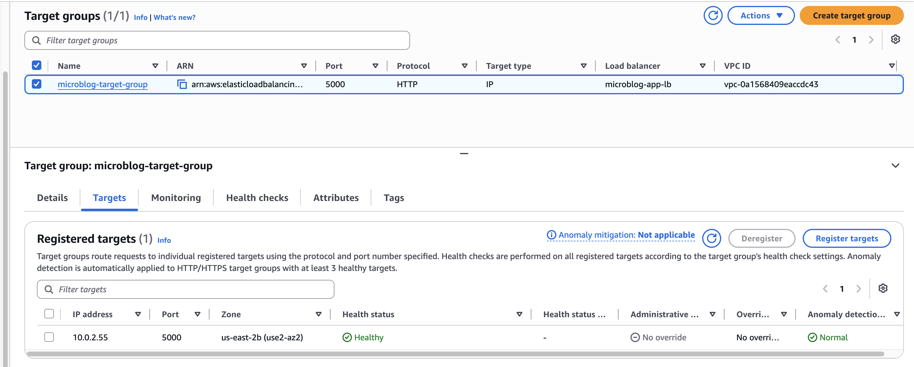
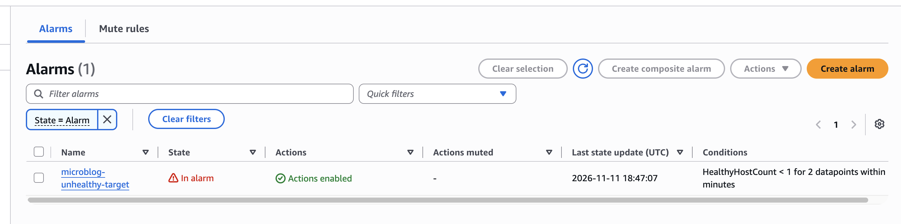
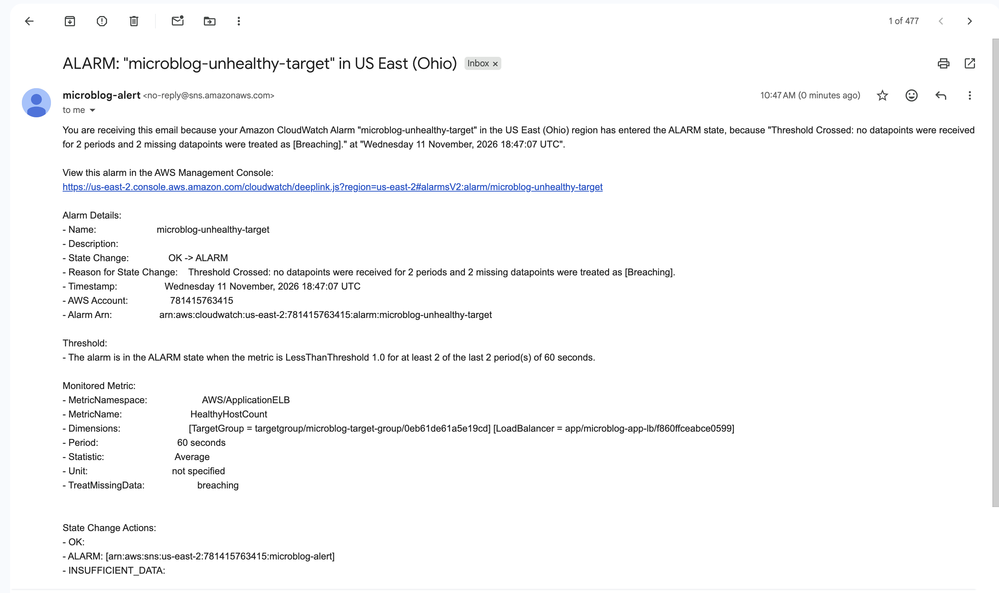
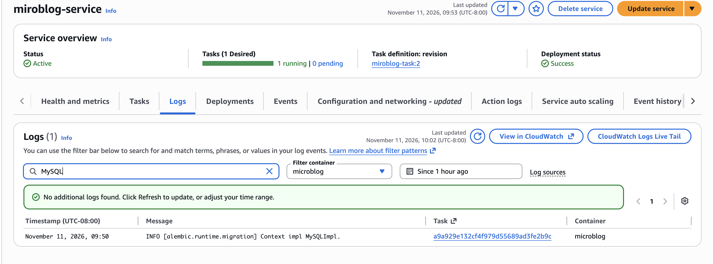

# Microblog on AWS

I deployed an open-source Flask app to AWS using ECS Fargate, an Application Load Balancer, and an RDS MySQL database. I set everything up by hand in the console. Next I'll rebuild it with Terraform.

The app is Miguel Grinberg's Microblog ([original repo](https://github.com/miguelgrinberg/microblog)), not mine. It's released under the MIT License, copyright Miguel Grinberg, and his LICENSE file is kept in this repo. The only thing I changed in the app was the Dockerfile. All of the AWS setup is mine.

<!-- 📸 PICTURE 1: the app loaded from the load balancer URL -->

## How it's set up

- A VPC with two public and two private subnets across two availability zones.
- The load balancer and the Fargate task are in the public subnets. The database is in the private subnets and isn't publicly accessible.
- The app's Docker image is in ECR. The task runs one container on port 5000.
- The database URL and the Flask secret key are in Secrets Manager and get passed to the container when it starts.
- Each security group only accepts traffic from the one in front of it: internet to load balancer on 80, load balancer to app on 5000, app to database on 3306.
- Container logs go to CloudWatch. An alarm watches the healthy target count and emails me through SNS.

<!-- 📸 PICTURE 2: VPC resource map -->

<!-- 📸 PICTURE 3: the security group inbound rules -->

<!-- 📸 PICTURE 4: the task definition JSON showing DATABASE_URL and SECRET_KEY under "secrets" -->

## Choices

I put the Fargate task in a public subnet because private subnets would need a NAT gateway, which costs money every hour. The task's security group only lets the load balancer in, so I was fine with that for a practice project. For a real app I'd use private subnets.

I also used one task and one database instance to keep costs down, so it isn't highly available.

## Does it work

The service runs one task and the target shows healthy.

<!-- 📸 PICTURE 5: target group with the target Healthy -->

To test the alarm I set the service to zero tasks. The alarm went to "In alarm" and I got the email. Then I set it back to one.

<!-- 📸 PICTURE 6: CloudWatch alarm in the "In alarm" state -->

<!-- 📸 PICTURE 7: the alert email -->

The startup logs show the database migrations running against MySQL, so the app is using RDS and not the SQLite fallback.

## What went wrong

- **Docker build failed.** The Dockerfile used `python:slim`, which pulled a Python version too new for a couple of the pinned packages, so they tried to compile and failed. I pinned the image to `python:3.11-slim`.
- **The task kept failing its health check.** I had put the secret ARNs in the task definition's `environment` section, so the app got the ARN text instead of the actual values. Moving them to `secrets` fixed it.
- **A subnet was in the wrong availability zone.** I saw it in the VPC resource map and recreated it, since RDS needs two zones.
- **No AWS CLI on my laptop,** so I built and pushed the image from CloudShell.

## What I'd change

- Put the tasks in private subnets.
- Add HTTPS and a domain name.
- Run RDS in Multi-AZ and use at least two tasks.
- Rebuild it all in Terraform.

## Cost

[ADD YOUR REAL NUMBER FROM THE BILLING PAGE.] The load balancer, database, and Fargate task all bill by the hour, so I shut them down when I'm not working on it.

**Tech:** AWS (VPC, ECS Fargate, ALB, RDS MySQL, Secrets Manager, ECR, IAM, CloudWatch, SNS, CloudShell), Docker, Flask
